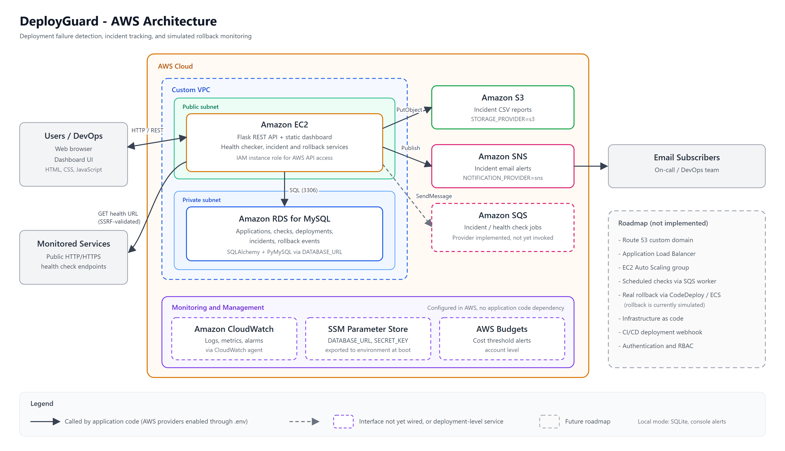

# DeployGuard

**Deployment failure detection and rollback monitoring platform, designed for deployment on AWS.**

DeployGuard is a full-stack Flask application that lets engineering teams register services, run security-hardened HTTP health checks, record deployment versions, automatically open and deduplicate incidents when checks fail, and run an audited rollback workflow. It runs locally on SQLite with no cloud dependencies, and its storage, notification, and queue layers are built behind provider interfaces so the same code can target Amazon RDS, S3, SNS, and SQS through configuration.

> **Rollback is currently simulated.** The rollback workflow validates the request, records a `RollbackEvent`, marks the source deployment `ROLLED_BACK`, and creates a new deployment record for the target version, but it does not change any running infrastructure. Every rollback response includes `"is_simulated": true`, and the generated deployment record is labeled `[SIMULATED ROLLBACK]`.

---

## Table of Contents

- [Problem Statement](#problem-statement)
- [Key Features](#key-features)
- [Workflow](#workflow)
- [Architecture](#architecture)
- [AWS Services](#aws-services)
- [Tech Stack](#tech-stack)
- [Project Structure](#project-structure)
- [Local Setup](#local-setup)
- [Environment Variables](#environment-variables)
- [API Reference](#api-reference)
- [Testing](#testing)
- [Deployment Notes](#deployment-notes)
- [Limitations](#limitations)
- [Future Improvements](#future-improvements)

---

## Problem Statement

After a release, teams often find out a deployment has broken a service only when users report it. Detecting the failure, opening an incident, and identifying the last known good version is usually manual and spread across several tools. DeployGuard brings these steps into one place: it probes service health endpoints, ties failures to incidents, keeps a version history per application, and records rollbacks to a previous version with a full audit trail.

---

## Key Features

| Area | What the code does |
|---|---|
| Application registry | Register, list, view, and delete monitored applications. Validates name length, HTTP/HTTPS URLs, and expected status code (100-599). Rejects duplicate names with `409`. Deleting an application cascades to its checks, deployments, incidents, and rollbacks. |
| Health checks | On-demand HTTP GET against each application's health URL. Records status (`HEALTHY` / `UNHEALTHY`), HTTP code, latency in milliseconds, and error message. |
| SSRF protection | Allows only `http`/`https`; blocks `localhost` aliases; resolves DNS and rejects private, loopback, link-local, multicast, reserved, and unspecified addresses, including the EC2 metadata endpoint `169.254.169.254`. Redirects are disabled. |
| Resource limits | Configurable request timeout (default 5 s) and response read cap (default 1 MB). |
| Incident management | A failed check opens an incident automatically. While an incident is `OPEN`, further failures reuse it instead of creating duplicates. Incidents can be resolved and filtered by status. |
| Notifications | A notification is sent when a new incident opens: console log by default, or Amazon SNS when configured. |
| Deployment tracking | Record deployments manually with version, status (`SUCCESS`, `FAILED`, `PENDING`, `ROLLED_BACK`), and notes. Filter by application. |
| Rollback workflow (simulated) | Roll back from one deployment to an earlier deployment of the same application. Records an auditable rollback event. See the note above. |
| Reporting | Export all incidents as CSV with open/resolve timestamps and duration. Each export is also saved to local disk or Amazon S3. |
| Dashboard | Single-page UI with totals for healthy and unhealthy applications, active incidents, and recent deployments, plus views for applications, deployments, incidents, health check history, and rollbacks. |

---

## Workflow

1. **Register** an application with its base URL, health check URL, and expected HTTP status.
2. **Record deployments** as new versions are released.
3. **Run a health check.** The URL is validated against SSRF rules, then probed.
4. **Detect failure.** If the status code does not match, or the request times out or fails, the check is stored as `UNHEALTHY` and an incident is opened (or the existing open incident is reused).
5. **Notify.** A new incident triggers a notification through the configured provider.
6. **Roll back** the failing deployment to a previous version. The rollback is simulated and recorded.
7. **Resolve** the incident and **export** the incident report as CSV.

---

## Architecture

### Application layers

- **Frontend:** static HTML, CSS, and JavaScript served by Flask from `frontend/`. It calls the REST API with `fetch`.
- **API layer:** Flask blueprints in `backend/routes/`, one per domain.
- **Service layer:** business logic in `backend/services/`. Storage, notification, queue, and rollback execution each sit behind a provider interface, chosen by environment variables.
- **Data layer:** SQLAlchemy 2.0 models (`Application`, `HealthCheck`, `Deployment`, `Incident`, `RollbackEvent`). Tables are created at startup. Any SQLAlchemy URL works; SQLite is the default and MySQL is supported through PyMySQL.

### AWS deployment architecture



How to read the diagram:

- **Request path:** users load the dashboard and call the REST API on a Flask application hosted on EC2 in the public subnet of a custom VPC. The application stores its data in RDS MySQL in a private subnet and sends SSRF-validated HTTP probes to the monitored services.
- **Solid arrows** are calls made by application code: S3 `PutObject` for incident reports and SNS `Publish` for incident alerts, each enabled through `.env`.
- **Dashed elements** are either interfaces that exist but are not yet called (the SQS provider), or services configured in AWS that the application code does not depend on (CloudWatch, SSM Parameter Store, AWS Budgets). These are grouped in the separate Monitoring and Management area.
- **Roadmap** items (Route 53, Application Load Balancer, Auto Scaling, scheduled checks, real rollback through CodeDeploy or ECS) are not implemented.

In local mode, the same application runs with SQLite, console notifications, and reports saved to `backend/reports/`, without an AWS account.

---

## AWS Services

The application runs fully offline by default. The table shows how each AWS service fits the design and exactly what the code implements today. The repository contains no infrastructure-as-code, so AWS resources are provisioned manually and are not defined or verified by this repository.

**Application tier and data**

| Service | Role in DeployGuard | Status in code |
|---|---|---|
| **Amazon EC2** | Hosts the Flask application. | Deployment-level. No EC2-specific code; the app runs on any Linux host. |
| **Custom VPC** | Public subnet for the app tier, private subnet for the database. | Deployment-level. |
| **Amazon RDS (MySQL)** | Primary database. | Supported through configuration: set `DATABASE_URL` to a `mysql+pymysql://` URL. PyMySQL is in `requirements.txt`. Not covered by the automated tests. |
| **Amazon S3** | Stores generated incident CSV reports under `reports/`. | Implemented (`S3StorageProvider`), enabled with `STORAGE_PROVIDER=s3`. |
| **Amazon SNS** | Publishes an alert when an incident opens; email subscriptions deliver it to the team. | Implemented (`SNSNotificationProvider`), enabled with `NOTIFICATION_PROVIDER=sns`. |
| **Amazon SQS** | Intended queue for incident and health check jobs. | Provider class implemented (`SQSQueueProvider`), but no route or worker calls it yet. Health checks run synchronously. |
| **IAM** | Instance role granting least-privilege access to S3, SNS, SQS, and SSM. | Deployment-level. The boto3 clients use the default credential chain, so an instance role works without code changes. |

**Monitoring and management**

| Service | Role in DeployGuard | Status in code |
|---|---|---|
| **Amazon CloudWatch** | Log collection, metrics, and alarms. | Not used by application code. Logs go to stdout; collection is done by the CloudWatch agent. |
| **SSM Parameter Store** | Source of secrets such as `DATABASE_URL` and `SECRET_KEY` on EC2. | Not used by application code. The app reads environment variables only, so parameters must be exported into the environment at boot (for example by a startup script). |
| **AWS Budgets** | Account-level cost threshold alerts. | Not related to application code. |

**Roadmap (not implemented)**

| Service | Intended role |
|---|---|
| **Route 53** | Custom domain for the dashboard and API. |
| **Application Load Balancer** | TLS termination and traffic distribution across instances. |
| **EC2 Auto Scaling** | Horizontal scaling of the app tier. Requires a shared database such as RDS, since SQLite is per-instance. |
| **AWS CodeDeploy / Amazon ECS** | Real rollback execution. Rollback is currently simulated. |

**Note:** `boto3` is imported only when an AWS provider is enabled and is **not** listed in `backend/requirements.txt`. Install it separately (`pip install boto3`) before enabling S3, SNS, or SQS.

---

## Tech Stack

| Layer | Technology |
|---|---|
| Language | Python 3 (developed on 3.13) |
| Web framework | Flask 3, Flask-CORS |
| ORM / database | SQLAlchemy 2.0, SQLite (default), PyMySQL for MySQL / RDS |
| HTTP client | requests |
| Configuration | python-dotenv |
| Frontend | HTML5, CSS3, vanilla JavaScript (no build step) |
| Testing | pytest |
| AWS SDK (optional) | boto3 |

---

## Project Structure

```text
.
├── run.py                       # Entry point: python run.py
├── .env.example                 # Environment variable template (copy to .env)
├── docs/
│   └── architecture.png         # AWS architecture diagram
├── backend/
│   ├── app.py                   # Flask app factory, /api/health, static file serving, error handlers
│   ├── config.py                # Config and TestConfig, loaded from environment / .env
│   ├── database.py              # SQLAlchemy engine, scoped session, table creation
│   ├── models.py                # Application, HealthCheck, Deployment, Incident, RollbackEvent
│   ├── requirements.txt
│   ├── routes/                  # REST endpoints: apps, health_checks, deployments,
│   │                            #   incidents, rollbacks, reports
│   └── services/
│       ├── health_checker.py    # HTTP probe with SSRF validation, timeout, size cap
│       ├── incident_service.py  # Incident creation, deduplication, resolution
│       ├── rollback_service.py  # Rollback workflow with simulated provider
│       ├── report_service.py    # Incident CSV generation
│       ├── storage_service.py   # Local disk or S3 provider
│       ├── notification_service.py  # Console or SNS provider
│       └── queue_service.py     # Direct or SQS provider (not yet wired)
├── frontend/
│   ├── index.html               # Single-page dashboard
│   ├── style.css
│   └── app.js                   # API calls and rendering
└── tests/                       # pytest suite (see Testing)
```

---

## Local Setup

**Prerequisites:** Python 3.10 or later and `pip`.

```bash
git clone https://github.com/Rohita-pb/DeployGuard-AWS-Mini-Project.git
cd DeployGuard-AWS-Mini-Project
```

Create and activate a virtual environment:

```bash
python -m venv .venv
```

```bash
# Windows PowerShell
.\.venv\Scripts\Activate.ps1
# macOS / Linux
source .venv/bin/activate
```

Install dependencies:

```bash
pip install -r backend/requirements.txt
```

Create your local environment file (see [Environment Variables](#environment-variables)):

```bash
cp .env.example .env        # PowerShell: Copy-Item .env.example .env
```

Start the server:

```bash
python run.py
```

Open `http://127.0.0.1:5000/` for the dashboard. The API is served from the same port under `/api`.

The defaults use a local SQLite database and console notifications, so no AWS account is needed to run the project.

---

## Environment Variables

All configuration is read from environment variables, loaded from a `.env` file in the project root if present. `.env` is listed in `.gitignore` and must never be committed.

| Variable | Default | Purpose |
|---|---|---|
| `SECRET_KEY` | built-in development value | Flask secret key. Set a long random value outside local development. |
| `HOST` / `PORT` | `127.0.0.1` / `5000` | Bind address for `run.py`. |
| `DATABASE_URL` | SQLite file in `backend/` | SQLAlchemy URL. The `.env.example` value `sqlite:///deployguard.db` creates the file in the working directory. For RDS: `mysql+pymysql://<user>:<password>@<endpoint>:3306/<db>`. |
| `ALLOW_LOCAL_HEALTHCHECKS` | `false` | Disables SSRF checks. Enable only for local testing. |
| `HEALTH_CHECK_TIMEOUT_SECONDS` | `5` | Probe timeout. |
| `MAX_RESPONSE_SIZE_BYTES` | `1048576` | Maximum bytes read from a probe response. |
| `AWS_REGION` | `us-east-1` | Region for boto3 clients. |
| `STORAGE_PROVIDER` / `S3_BUCKET_NAME` | `local` / empty | Set to `s3` with a bucket name to store reports in S3. |
| `NOTIFICATION_PROVIDER` / `SNS_TOPIC_ARN` | `local` / empty | Set to `sns` with a topic ARN to publish incident alerts. |
| `QUEUE_PROVIDER` / `SQS_QUEUE_URL` | `direct` / empty | Selects the queue provider (not yet used by any route). |

Each AWS provider falls back to its local implementation if its bucket, topic, or queue value is empty.

**Handling secrets**

- Keep real values only in `.env` locally, or in SSM Parameter Store (SecureString) when deployed.
- Do not put AWS access keys in `.env` on EC2. Use an IAM instance role; boto3 picks it up automatically.
- The placeholder ARNs and URLs in `.env.example` are examples only.

---

## API Reference

All endpoints return JSON with a `success` flag, except the CSV export.

| Method | Endpoint | Description |
|---|---|---|
| `GET` | `/api/health` | Service status and database connectivity |
| `GET` | `/api/dashboard` | Application, health, incident, and recent deployment summary |
| `GET` | `/api/apps` | List applications with latest status |
| `POST` | `/api/apps` | Register an application |
| `GET` | `/api/apps/<id>` | Application details with recent checks, deployments, open incidents |
| `DELETE` | `/api/apps/<id>` | Delete an application and its related records |
| `POST` | `/api/apps/<id>/check` | Run a health check and evaluate incidents |
| `GET` | `/api/apps/<id>/checks?limit=50` | Health check history for one application |
| `GET` | `/api/checks?limit=50` | Recent health checks across all applications |
| `GET` | `/api/deployments?application_id=<id>` | List deployments, newest first |
| `POST` | `/api/deployments` | Record a deployment |
| `GET` | `/api/incidents?status=OPEN` | List incidents, optionally filtered by status |
| `PATCH` | `/api/incidents/<id>/resolve` | Resolve an incident |
| `GET` | `/api/rollbacks` | Rollback history |
| `POST` | `/api/deployments/<id>/rollback` | Simulated rollback to `target_deployment_id` |
| `GET` | `/api/reports/incidents.csv` | Download the incident report as CSV |

### Example: end-to-end flow with curl

```bash
# Register an application
curl -X POST http://127.0.0.1:5000/api/apps -H "Content-Type: application/json" -d '{"name":"Payments API","base_url":"https://httpbin.org","health_check_url":"https://httpbin.org/status/200","expected_status_code":200}'
```

```bash
# Run a health check
curl -X POST http://127.0.0.1:5000/api/apps/1/check
```

Health check response (abridged):

```json
{
  "success": true,
  "data": {
    "check": { "status": "HEALTHY", "http_status_code": 200, "response_time_ms": 142.35, "error_message": null },
    "incident": null,
    "is_incident_created": false
  }
}
```

```bash
# Record two deployments
curl -X POST http://127.0.0.1:5000/api/deployments -H "Content-Type: application/json" -d '{"application_id":1,"version":"v1.0.0","status":"SUCCESS"}'
curl -X POST http://127.0.0.1:5000/api/deployments -H "Content-Type: application/json" -d '{"application_id":1,"version":"v1.1.0","status":"FAILED","notes":"Error rate spike"}'
```

```bash
# Roll back deployment 2 to deployment 1 (simulated)
curl -X POST http://127.0.0.1:5000/api/deployments/2/rollback -H "Content-Type: application/json" -d '{"target_deployment_id":1}'
```

Rollback response (abridged):

```json
{
  "success": true,
  "is_simulated": true,
  "message": "Rollback simulated successfully from version v1.1.0 to v1.0.0.",
  "data": { "source_version": "v1.1.0", "target_version": "v1.0.0", "status": "SIMULATED_SUCCESS" },
  "new_deployment": { "version": "v1.0.0", "status": "SUCCESS", "notes": "[SIMULATED ROLLBACK] Rolled back from version v1.1.0 to target version v1.0.0." }
}
```

On Windows PowerShell, use `curl.exe` or `Invoke-RestMethod` instead of the `curl` alias.

---

## Testing

```bash
python -m pytest -v
```

The suite uses an in-memory SQLite database and `TestConfig`, so it needs no network access or AWS credentials.

| Test file | Coverage |
|---|---|
| `test_health.py` | `/api/health` and database connectivity |
| `test_apps.py` | Registration, validation, duplicates, listing, deletion |
| `test_health_checks.py` | Healthy and unhealthy probes, timeouts, SSRF blocking |
| `test_incidents.py` | Incident creation, deduplication, resolution |
| `test_deployments.py` | Recording, listing, and validating deployments |
| `test_rollbacks.py` | Simulated rollback, status updates, invalid deployment IDs |
| `test_reports.py` | CSV headers and content type |
| `test_persistence.py` | Data survives an engine restart on a file database |
| `test_live.py` | End-to-end flow against a running server; skipped unless `python run.py` is running |

Current result: **17 passed, 1 skipped** (the live test, when no server is running).

---

## Deployment Notes

Deployment is a manual process; this repository contains no infrastructure-as-code or CI/CD pipeline. A typical setup on AWS:

1. **Network:** create a custom VPC with a public subnet for EC2 and private subnets for RDS. Allow MySQL (3306) on the RDS security group only from the EC2 security group.
2. **Database:** create an RDS MySQL instance and a database. Tables are created automatically on first start.
3. **Secrets:** store `DATABASE_URL` and `SECRET_KEY` in SSM Parameter Store as SecureString values and export them into the environment at boot.
4. **IAM:** attach an instance role with least-privilege permissions: `s3:PutObject` / `s3:GetObject` on the report bucket, `sns:Publish` on the topic, `ssm:GetParameter` on the app's parameters, and `sqs:SendMessage` if the queue is used.
5. **Application:** install the dependencies plus `boto3`, set `STORAGE_PROVIDER=s3` and `NOTIFICATION_PROVIDER=sns` with their resource names, and run under a production WSGI server, for example:

   ```bash
   pip install gunicorn boto3
   gunicorn -w 4 -b 0.0.0.0:5000 "backend.app:create_app()"
   ```

6. **Alerts:** subscribe team email addresses to the SNS topic and confirm the subscriptions.
7. **Monitoring and cost:** use the CloudWatch agent to ship logs, add alarms on CPU and HTTP errors, and set an AWS Budgets threshold alert.

Route 53, an Application Load Balancer, and Auto Scaling are roadmap items and are not part of the current setup.

**Important:** `run.py` starts Flask's development server with debug mode on. Do not use it in production.

---

## Limitations

- **Rollback is simulated.** No deployment tool (CodeDeploy, ECS, Kubernetes) is called. `SimulatedDeploymentProvider` is the only implementation.
- **Health checks are manual.** They run synchronously when triggered from the UI or API; there is no scheduler.
- **SQS is not wired in.** The queue provider exists, but nothing enqueues or consumes jobs.
- **SSM, CloudWatch, Budgets, VPC, and IAM** are deployment-level concerns with no supporting code.
- **No load balancer, DNS, or auto scaling.** Route 53, ALB, and Auto Scaling are roadmap items.
- **No deployment automation.** There is no infrastructure-as-code or CI/CD pipeline; AWS setup is manual.
- **Deployments are recorded manually.** There is no CI/CD webhook.
- **No authentication or authorization.** CORS allows all origins on `/api/*`.
- **AWS paths are untested.** The S3, SNS, SQS, and MySQL code paths are not exercised by the test suite, and `boto3` is not in `requirements.txt`.
- **Schema management** uses `create_all` with no migrations.

---

## Future Improvements

- Integrate a real rollback provider (AWS CodeDeploy or ECS) behind the existing `DeploymentProviderInterface`.
- Schedule periodic health checks through SQS with a worker on EC2 or AWS Lambda.
- Load configuration directly from SSM Parameter Store at startup.
- Add structured logging and publish custom CloudWatch metrics such as check latency and incident count.
- Add authentication and role-based access control, and restrict CORS.
- Add a CI/CD webhook to record deployments automatically.
- Define the infrastructure as code (Terraform or CloudFormation) and add Alembic migrations.
- Add `boto3` to requirements and test the AWS providers with mocks (for example, moto).
